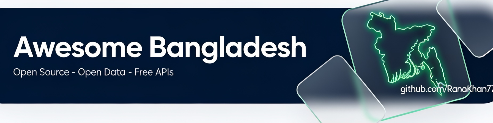

# Awesome Bangladesh 

    
    
  <strong>Made in Bangladesh — Open Source · Open Data · Free APIs</strong>

 

A curated directory of open-source software, datasets, APIs and research built by
Bangladeshis — at home or in the diaspora — or built for Bangladesh. It connects
developers, researchers and open-data users to the country's open ecosystem across
GitHub, package registries, Hugging Face, Kaggle and government portals.

Everything listed here is **verified**: each entry has a Bangladesh connection we can
point to (based-in-Bangladesh maintainer, verified diaspora maintainer, Bangladeshi
organisation, or a product explicitly built for Bangladesh) plus licence and activity
information captured at verification time. Items we could not yet verify are tracked
openly in the [verification queue](docs/verification-queue.md) instead of being listed.
Items that went unmaintained move to [legacy.md](legacy.md) — still useful, honestly
labelled with last-activity dates, never silently deleted.

Maintained by [Rana Khan](https://github.com/RanaKhan77). Contributions welcome — see
[Contributing](CONTRIBUTING.md), and please read the
scope and eligibility rules first.

## Contents

- [🧰 Developer tools & libraries](#-developer-tools--libraries)
- [🗃️ Datasets & open data](#-datasets--open-data)
- [🔌 APIs & integrations](#-apis--integrations)
- [🇧🇩 Bangla language & NLP](#-bangla-language--nlp)
- [🤖 AI/ML & research](#-aiml--research)
- [💒 Fintech & e-commerce](#-fintech--e-commerce)
- [🛡️ Cybersecurity & privacy](#-cybersecurity--privacy)
- [🏛️ Civic tech & public services](#-civic-tech--public-services)
- [🚨 Crisis response](#-crisis-response)
- [🗺️ Geography & open maps](#-geography--open-maps)
- [🎓 Education & learning](#-education--learning)
- [📚 Awesome lists & communities](#-awesome-lists--communities)
- [🏪 Developer services (not open)](#-developer-services-not-open)

## 🧰 Developer tools & libraries

> 📖 Deep dive with full tables and picks: [section guide](docs/sections/developer-tools.md)

- [DownGit](https://github.com/MinhasKamal/DownGit) - Download any GitHub directory or file as a zip archive. MIT.
- [@waveinno/ui](https://www.npmjs.com/package/@waveinno/ui) - "The React design system from Bangladesh". MIT.
- [banglaclaw](https://github.com/Entrogic/banglaclaw) - Web-scraping toolkit built for Bangladeshi use cases, also on [npm](https://www.npmjs.com/package/banglaclaw). Apache-2.0.
- [filex-editor](https://www.npmjs.com/package/filex-editor) - Bangla-first terminal text editor. MIT.
- [Online-Compiler](https://github.com/shawon100/Online-Compiler) - Self-hosted online compiler platform. ⚠️ No licence file.
- [docker-beanstalkd](https://github.com/maateen/docker-beanstalkd) - Docker image for the Beanstalkd work queue. MIT.
- [vim-for-devops](https://github.com/maateen/vim-for-devops) - DevOps-tuned Vim configuration. Custom licence.

## 🗃️ Datasets & open data

> 📖 Deep dive with full tables and picks: [section guide](docs/sections/datasets.md)

Government portals:

- [Bangladesh Open Data Portal](https://data.gov.bd/) - ~90 datasets from 35+ ministries (economy, health, education, agriculture). ⚠️ Licence unspecified per dataset — verify on the dataset page before reuse.
- [Open Government Data Portal](https://ogdnew.sdg.gov.bd/) - National OGD portal (now hosted at sdg.gov.bd) with 130+ datasets. ⚠️ Licence unspecified — verify on the dataset page before reuse.
- [Bangladesh Bureau of Statistics](https://bbs.gov.bd/) - Official statistics, surveys and census downloads. ⚠️ Licence unspecified per release.

Curated datasets on GitHub and Hugging Face:

- [Bangladesh-Administrative-Data](https://github.com/goshamishagar/Bangladesh-Administrative-Data) - Administrative divisions with Bangla and English names. CC0-1.0.
- [Bangla-Alphabet](https://github.com/lifeparticle/Bangla-Alphabet) - Bangla alphabet dataset for ML. MIT.
- [Bangladesh-Legal-Acts-Dataset](https://huggingface.co/datasets/sakhadib/Bangladesh-Legal-Acts-Dataset) - Laws of Bangladesh, machine-readable. CC-BY-4.0.
- [bangla-bagdhara](https://huggingface.co/datasets/sakhadib/bangla-bagdhara) - Bangla idioms (bagdhara) dataset. CC-BY-SA-4.0.
- [xlsum](https://huggingface.co/datasets/csebuetnlp/xlsum) - Large-scale multilingual summarisation dataset covering Bangla news. ⚠️ CC BY-NC-SA 4.0 — non-commercial.
- [BanglaNMT](https://huggingface.co/datasets/csebuetnlp/BanglaNMT) - Bangla-English parallel corpus. ⚠️ CC BY-NC-SA 4.0 — non-commercial.
- [CommonVoiceBangla](https://huggingface.co/datasets/bengaliAI/CommonVoiceBangla) - Bangla speech corpus. CC0-1.0.
- [titulm-bangla-corpus](https://huggingface.co/datasets/hishab/titulm-bangla-corpus) - 24.3M-document Bangla pre-training corpus (147 GB) from Hishab, the Dhaka AI company behind the TituLM family. CC-BY-4.0.
- [BanglaEng-SynCorpus](https://huggingface.co/datasets/Eamin-sust/BanglaEng-SynCorpus) - Synthetic Bangla-English parallel corpus built by SUST CSE faculty. CC-BY-4.0.
- [SUBAK.KO](https://huggingface.co/datasets/SUST-CSE-Speech/SUBAK.KO) - Bangla speech corpus from the SUST CSE speech lab. CC-BY-4.0.
- [Bengali.AI datasets portal](https://www.bengali.ai/datasets/) - Open training partitions for Bengali language research (Ben-10, document layout, speech, handwriting) hosted on Kaggle and Hugging Face.
- [Numta](https://github.com/BengaliAI/Numta) - Handwritten Bangla digit dataset. MIT.
- [BADLAD](https://github.com/BengaliAI/BADLAD) - Bangla document layout analysis dataset. ⚠️ No licence file.
- [BanglaSocialBias](https://huggingface.co/datasets/csebuetnlp/BanglaSocialBias) - Social bias measurement dataset for Bangla. CC-BY-4.0.
- [bangladeshi-jobs](https://huggingface.co/datasets/swadhinbiswas/bangladeshi-jobs) - Weekly-refreshed Bangladeshi tech-jobs dataset. CC-BY-4.0.
- [Bangla_Financial_news](https://huggingface.co/datasets/ashtrayAI/Bangla_Financial_news_articles_Dataset) - Bangla financial news corpus used for DSE stock prediction research. CC0-1.0.
- [bangladesh-stock-market-dataset](https://huggingface.co/datasets/kawsersikder/bangladesh-stock-market-dataset) - Dhaka Stock Exchange daily data for ABBANK to BRACBANK and beyond. CC-BY-4.0.
- [MediBeng](https://huggingface.co/datasets/pr0mila-gh0sh/MediBeng) - Synthetic code-switched Bengali-English clinical dialogues (audio, parallel text, speaker metadata) for ASR, TTS and translation research, by a Khulna-based researcher. CC-BY-4.0.
- [BanglishRev e-commerce reviews](https://huggingface.co/datasets/BanglishRev/bangla-english-and-code-mixed-ecommerce-review-dataset) - 1.74M Daraz reviews, Bangla-English code-mixed; companion paper by UIU Dhaka faculty (arXiv 2412.13161). ⚠️ CC BY-NC-SA 4.0 — non-commercial.
- [BanglaRQA](https://huggingface.co/datasets/sartajekram/BanglaRQA) - Reading-comprehension benchmark in Bangla from University of Chittagong researchers. ⚠️ CC BY-NC-SA 4.0 — non-commercial.
- [Bangla-Instruct](https://huggingface.co/datasets/md-nishat-008/Bangla-Instruct) - 172k instruction-tuning pairs built from 163 NCTB textbooks (ACL 2025). MIT.

Notable Kaggle datasets about Bangladesh:

- [RSUD20K — Bangladesh Road Scene Understanding](https://www.kaggle.com/datasets/hasibzunair/rsud20k-bangladesh-road-scene-understanding) - 20k annotated road-scene images. ⚠️ CC BY-NC 4.0.
- [Assorted Medicine Dataset of Bangladesh](https://www.kaggle.com/datasets/ahmedshahriarsakib/assorted-medicine-dataset-of-bangladesh) - Brand and generic medicine data. CC0.
- [Bangla Newspaper Dataset](https://www.kaggle.com/datasets/furcifer/bangla-newspaper-dataset) - 400k+ Bangla news articles from Bangladeshi papers.
- [Bangladesh District-wise Population](https://www.kaggle.com/datasets/msjahid/bangladesh-districts-wise-population) - District population statistics. Apache-2.0.
- [Bangladesh Weather Dataset 1901–2023](https://www.kaggle.com/datasets/yakinrubaiat/bangladesh-weather-dataset) - Century of climate observations. CC-BY-4.0.
- [Dengue Dataset Bangladesh](https://www.kaggle.com/datasets/kawsarahmad/dengue-dataset-bangladesh) - Dengue cases over time. CC-BY-4.0.
- [Dhaka AI Traffic Detection Dataset](https://www.kaggle.com/datasets/rifat963/dhakaai-dhaka-based-traffic-detection-dataset) - Dhaka traffic detection for smart-city research. GPL-2.0.
- [Dhaka Stock Exchange Historical Data](https://www.kaggle.com/datasets/shuvokumarbasak2030/bd-dhaka-stock-exchange-historical-data-s1999-2023) - DSE historical prices 1999–2023. MIT.
- [House Rent in Dhaka City](https://www.kaggle.com/datasets/taeefnajib/house-rent-in-dhaka-city) - Rental listings dataset. ⚠️ CC BY-NC 4.0.
- [COVID-19 in Bangladesh](https://www.kaggle.com/datasets/jhossain/covid19-in-bangladesh) - Pandemic case data.
- [Bangladesh 2026 National Election Candidates](https://www.kaggle.com/datasets/dkhalidashik/candidate-info-2026-national-election-bangladesh) - Candidate list for the 13th Jatiya Sangsad election. Apache-2.0.
- [Bangladesh Road Accident News 2014-2025](https://www.kaggle.com/datasets/altakvirahmedjisan/bangladesh-road-accident-data-from-prothom-alo) - ~3,000 road-accident reports scraped from Prothom Alo. MIT.
- [Dengue and Weather Data Bangladesh](https://www.kaggle.com/datasets/brownsugar297/dengue-and-weather-data-bangladesh-20222025) - Spatio-temporal dengue + weather data from DGHS, all eight divisions. CC-BY-4.0.
- [July Revolution Sentiment (Bangla)](https://www.kaggle.com/datasets/sabbir5622r/july-revolution-sentiment-analysis-dataset-bangla) - Public-sentiment corpus from the July 2024 uprising; companion paper arXiv 2507.11084. CC-BY-4.0.
- [Bengali OCR Dataset 1M](https://www.kaggle.com/datasets/mnsm92/bengali-ocr-dataset-1m) - 1M annotated printed and handwritten images for Bangla OCR. MIT.
- [BanglaLekha-Isolated](https://data.mendeley.com/datasets/hf6sf8zrkc/2) - 166,105 handwritten isolated-character images (50 basic, 10 numerals, 24 compound) with writer demographics and aesthetic-quality ratings, from University of Liberal Arts Bangladesh researchers; companion paper in Data in Brief. CC-BY-4.0.
- [SUBESCO Bangla Speech Emotion](https://www.kaggle.com/datasets/sushmit0109/subescobangla-speech-emotion-dataset) - Audio-only emotional speech corpus from SUST researchers. ⚠️ CC BY-NC-SA 4.0 — non-commercial.
- [Bangla Isolated Speech Dataset](https://www.kaggle.com/datasets/mehrabhosain/bangla-isolated-speech-dataset) - 1,800 isolated-word samples in Bangla and English (published 2025; also on Mendeley Data). LGPL-3.0.

- [BangladeshExport Export Statistics](https://bangladeshexport.com/export-statistics) - Bangladesh export statistics organised from official sources (EPB, Bangladesh Bank, NBR Customs, BIDA): monthly and full-year totals, HS-code product breakdowns, top destinations and regional splits, with downloadable XLSX and source-link dates shown. Free to access.

International open-data hosts carrying Bangladesh data:

- [IOM NPM Cox's Bazar UAV imagery](https://data.humdata.org/dataset/iom-npm-cox-bazar-uav-imagery) - Needs and Population Monitoring imagery for the Rohingya refugee camps, from IOM Bangladesh. CC-BY-4.0 (HDX open licence).
- [OpenDengue](https://doi.org/10.6084/m9.figshare.24259573) - Open global dengue case database including Bangladesh monthly and daily DGHS-sourced series. CC-BY-4.0.
- [Common Voice Scripted Speech 27.0 (Bengali)](https://mozilladatacollective.com/datasets/cmu5kut0d00pomh07yay2f34r) - Mozilla's official current Bengali scripted-speech release: over a million clips and 1,277 hours of read speech from 23,019 speakers — a newer, larger distribution than the [CommonVoiceBangla](https://huggingface.co/datasets/bengaliAI/CommonVoiceBangla) copy above. CC0-1.0.
- [Bengali Wikipedia dumps](https://dumps.wikimedia.org/bnwiki/latest/) - Wikimedia's always-current database dumps of the Bengali Wikipedia — the canonical raw corpus behind most Bangla NLP work, pages-articles multistream included. Content CC BY-SA; dumps free to download.

## 🔌 APIs & integrations

> 📖 Deep dive with full tables and picks: [section guide](docs/sections/apis.md)

- [bdapis](https://github.com/AbmSourav/bdapis) - REST API for divisions, districts, upazilas, thanas, post offices and postcodes in Bangla and English; live at [bdapis.com](https://bdapis.com/). MIT.
- [bdapi4all](https://github.com/fakhrul62/bdapi4all) - One keyless API for BD geography, prayer times, holidays, exchange rates and validators. ⚠️ Licence unspecified.
- [bd-apis](https://github.com/SudipMHX/bd-apis) - Community collection of Bangladesh-focused APIs. ⚠️ No licence file.
- [bangla-apis](https://github.com/rdnasim/bangla-apis) - Curated directory of BD-context APIs (payments, couriers, SMS, government, banking, laws) with auth/pricing columns; reviewed October 2026. Linked as a reference directory (no licence — data is not copied).
- [Bangladesh Bank daily rates](https://allratestoday.com/api/open/central-bank/bb) - Keyless JSON endpoint serving Bangladesh Bank's official published exchange rates (maintained by AllRatesToday with visible attribution).
- [World Bank Bangladesh API](https://api.worldbank.org/v2/country/BGD/indicator/SP.POP.TOTAL?format=json) - Keyless REST API for every World Bank Bangladesh indicator, population to GDP (external service, CC-BY-4.0 terms).
- [Bangladesh Railway e-ticketing API](https://railspaapi.shohoz.com/v1.0/web/all-trains/info) - Keyless JSON API behind the official Shohoz rail e-ticketing site — unofficial, no published terms; use respectfully.
- [Open-Meteo (Bangladesh)](https://api.open-meteo.com/v1/forecast?latitude=23.8103&longitude=90.4125&hourly=temperature_2m) - Free keyless weather forecasts and history for any Bangladeshi coordinate (external service, non-commercial free tier, CC-BY-4.0).
- [bangladesh-bank-exchange-rate](https://www.npmjs.com/package/bangladesh-bank-exchange-rate) - npm client for Bangladesh Bank's daily published rates. MIT.
- [ExchangeRate-API open endpoint](https://open.er-api.com/v6/latest/BDT) - Free, keyless exchange rates for BDT, refreshed daily (community endpoint of ExchangeRate-API; external service, useful until Bangladesh Bank publishes an API).
- [Prothom Alo RSS](https://www.prothomalo.com/feed) - Verified RSS 2.0 feed of the leading Bangla daily.
- [The Daily Star RSS](https://www.thedailystar.net/frontpage/rss.xml) - Front-page feed of the leading English daily.
- [barta](https://github.com/iRaziul/barta) - Bangladeshi SMS gateways for Laravel. MIT.
- [laravelbdsms](https://github.com/arif98741/laravelbdsms) - Multi-gateway SMS package for Laravel covering Bangladeshi providers. MIT.
- [sms-service-with-bd-providers](https://github.com/sarahman/sms-service-with-bd-providers) - Laravel SMS service across BD providers. ⚠️ Licence unspecified.

## 🇧🇩 Bangla language & NLP

> 📖 Deep dive with full tables and picks: [section guide](docs/sections/bangla-nlp.md)

Input methods and phonetics:

- [OpenBangla-Keyboard](https://github.com/OpenBangla/OpenBangla-Keyboard) - The leading open-source Bangla keyboard for Linux. GPL-3.0.
- [riti](https://github.com/OpenBangla/riti) - Next-generation Bangla input method engine in Rust. MPL-2.0.
- [jsAvroPhonetic](https://github.com/torifat/jsAvroPhonetic) - Avro Phonetic conversion in JavaScript. ⚠️ No licence file.
- [iAvro](https://github.com/torifat/iAvro) - Avro Phonetic for macOS. ⚠️ No licence file.
- [Lekho](https://github.com/ARahim3/Lekho) - Avro Phonetic input for Apple Silicon Macs. Custom licence.
- [Bangla-Keyboard](https://github.com/wpexpertinbd/Bangla-Keyboard) - Fixed-layout Bangla keyboard for macOS, Windows and Linux from one shared reordering engine. MIT.
- [BornoTSF](https://github.com/JayedAhsan/BornoTSF) - Lightweight Windows Text Services Framework IME for Bangla typing, by Codepotro. GPL-3.0.
- [khipro-m17n](https://github.com/rank-coder/khipro-m17n) - Compositional Bangla input method - neither phonetic nor an app - for Linux, Windows and Android. MIT.
- [Bongo](https://github.com/mehedishakeel/Bongo) - Cross-platform Avro-style phonetic keyboard for macOS, Windows, Linux and Android, built on the riti engine. MPL-2.0.
- [@subhesadek/avro-phonetic](https://www.npmjs.com/package/@subhesadek/avro-phonetic) - Avro Phonetic parser for the web. MPL-2.0.
- [avro.py](https://github.com/hitblast/avro.py) - Avro Phonetic parser in Python. Apache-2.0.
- [Bijoy2Unicode](https://github.com/JehadurRE/Bijoy2Unicode) - Bijoy to Unicode converter. MIT.

Rust crates by the OpenBangla community:

- [okkhor](https://crates.io/crates/okkhor) - Unicode to Bijoy and back.
- [poriborton](https://crates.io/crates/poriborton) - Unicode-Bijoy converter library.
- [upodesh](https://crates.io/crates/upodesh) - Autosuggest engine for Bangla input.
- [emojicon](https://crates.io/crates/emojicon) - Emoji handling with Bangla text.
- [ponjika](https://crates.io/crates/ponjika) - Bengali (Bangladeshi) calendar library.
- [bangla](https://crates.io/crates/bangla) - Number formatting and calendar utilities for Bangla.
- [obadh_engine](https://github.com/unmukto-org/obadh_engine) - Deterministic rule-based Roman-to-Bangla transliteration engine in Rust, powering the Obadh keyboards for Apple platforms. MIT.

NLP toolkits and models:

- [bnlp](https://github.com/sagorbrur/bnlp) - Bangla natural language processing toolkit (tokenisation, stemming, POS, NER). MIT.
- [bnltk](https://github.com/asraf-patoary/bnltk) - Bangla NLP toolkit in Python. MIT.
- [BanglaSpeech2Text](https://github.com/shhossain/BanglaSpeech2Text) - Offline Bangla speech recognition. Apache-2.0.
- [bangla-tts](https://github.com/zabir-nabil/bangla-tts) - Bangla text-to-speech research code. ⚠️ No licence file.
- [Nirmol](https://github.com/Sigmakib2/Nirmol) - Bangla slang detection dataset and API. ⚠️ No licence file.
- [BengaliDictionary](https://github.com/MinhasKamal/BengaliDictionary) - English-to-Bengali dictionary dataset and tools. GPL-3.0.
- [avro-bangla-autocorrect-dictionary-enriched](https://github.com/afnan-hossain/avro-bangla-autocorrect-dictionary-enriched) - Enriched Avro autocorrect dictionary. ⚠️ No licence file.
- [laya-bangla](https://github.com/shamspias/laya-bangla) - Bangla-first LLM routing layer. Apache-2.0.
- [bangla-embed-e5-small-banglish](https://huggingface.co/kazalbrur/bangla-embed-e5-small-banglish) - Bangla/Banglish sentence embeddings. MIT.
- [bangla-asr-conformer-120m-dialects](https://huggingface.co/kazalbrur/bangla-asr-conformer-120m-dialects) - Dialect-aware Bangla speech recognition. Apache-2.0.

Dates, numbers and text utilities:

- [number-to-bangla](https://github.com/rakibdevs/number-to-bangla) - Convert numbers to Bangla words and digits (Laravel/PHP). MIT.
- [bangla-to-banglish](https://www.npmjs.com/package/bangla-to-banglish) - Bangla script to Banglish transliteration. MIT.
- [bangla-likhi](https://www.npmjs.com/package/bangla-likhi) - Bangla typing made easy. MIT.
- [bangla-pdf](https://www.npmjs.com/package/bangla-pdf) - Generate PDFs with Bangla text (Node). BSD-3-Clause.
- [banglapdf](https://pypi.org/project/banglapdf/) - Bangla PDF generation for Python. MIT.
- [bangla-web-fonts](https://github.com/maateen/bangla-web-fonts) - Bangla web fonts packaged for the web. ⚠️ No licence file.
- [thikkit](https://www.npmjs.com/package/thikkit) - Bilingual Bangla-English address parsing (ঠিকানা = address). MIT.
- [bangla-to-english-name-translator](https://www.npmjs.com/package/bangla-to-english-name-translator) - Converts Bangla person names to English (শাহানাহিদ → Shahanaheed). MIT.
- [transliteration-bangla](https://www.npmjs.com/package/transliteration-bangla) - Banglish-to-Bangla transliteration running ONNX models in the browser. MIT.
- [@pantho075/matra](https://www.npmjs.com/package/@pantho075/matra) - Bangla character stroke-order data and heuristics (মাত্রা). MIT.
- [bangla-ipa](https://pypi.org/project/bangla-ipa/) - Bangla text to IPA transliteration, by Bangladeshi NLP researchers (open source, GitHub bipsec/bangla-ipa).
- [bn-i18n-notes](https://codeberg.org/adnan360/bn-i18n-notes) - Guidelines for translating software projects from English to Bangla, written in Bangla (Codeberg). GPL-3.0.

Typesetting:

- [LaTeXbangla](https://github.com/Neehan/LaTeXbangla) - Write Bangla (and Assamese) with ordinary LaTeX. LPPL-1.3c.
- [BOOKbangla](https://github.com/Neehan/BOOKbangla) - Book class and templates for writing Bangla and Assamese books with LaTeX memoir. LPPL-1.3c.

## 🤖 AI/ML & research

> 📖 Deep dive with full tables and picks: [section guide](docs/sections/aiml.md)

- [banglagov (Hugging Face)](https://huggingface.co/banglagov) - Official Hugging Face org of the Bangla.gov.bd government initiative: banGPT2-Base, banBERT-Base, banELECTRA-Base and banT5-Base pretrained models plus the Ban-Sign-Sent-9K sign-language dataset. Licence terms per model card.
- [BanglaBERT](https://github.com/csebuetnlp/banglabert) - Pretrained Bangla language models from the BUET NLP group. ⚠️ CC BY-NC-SA 4.0 — non-commercial.
- [BanglaNLG](https://github.com/csebuetnlp/BanglaNLG) - BanglaT5 generation and summarisation models. ⚠️ No licence file.
- [mT5_multilingual_XLSum](https://huggingface.co/csebuetnlp/mT5_multilingual_XLSum) - Multilingual summarisation checkpoint covering Bangla. ⚠️ CC BY-NC-SA 4.0 — non-commercial.
- [normalizer](https://github.com/csebuetnlp/normalizer) - Bangla text normalisation utilities used across the csebuetnlp stack. ⚠️ No licence file.
- [xl-sum](https://github.com/csebuetnlp/xl-sum) - Research code for the XL-Sum summarisation dataset. ⚠️ No licence file.
- [CrossSum](https://github.com/csebuetnlp/CrossSum) - Cross-lingual summarisation across 45 languages. ⚠️ No licence file.
- [IllusionVQA](https://github.com/csebuetnlp/IllusionVQA) - Optical-illusion visual question answering benchmark. ⚠️ No licence file.
- [bangla-bert-base](https://huggingface.co/sagorsarker/bangla-bert-base) - Community Bangla BERT, one of the most-used Bangla encoders on Hugging Face. MIT.
- [bangla-bert](https://github.com/sagorbrur/bangla-bert) - Training and fine-tuning code for Bangla BERT models. MIT.
- [bbocr](https://github.com/BengaliAI/bbocr) - Bangla handwriting OCR research. BSD-3-Clause.
- [graphemePrepare](https://github.com/BengaliAI/graphemePrepare) - Grapheme recognition data preparation. MIT.
- [BanglaConformer](https://huggingface.co/bengaliAI/BanglaConformer) - Conformer-based Bangla speech recognition model. MIT.
- [BangalASR](https://github.com/menon92/BangalASR) - Automatic Bangla speech recognition experiments. MIT.
- [Bangla-Word2Vec](https://github.com/menon92/Bangla-Word2Vec) - Pretrained Bangla word embeddings. MIT.
- [banglanlptoolkit](https://pypi.org/project/banglanlptoolkit/) - All-in-one Bangla NLP toolkit from ACI MIS AI and Intelsense AI teams. ⚠️ Licence unspecified.
- [BanglaBBQ](https://github.com/SummitAnthony/BanglaBBQ-benchmark) - Bias benchmark for question answering in the Bangladeshi context. MIT.
- [bangla-speech-to-text-benchmark](https://github.com/riverbornai/bangla-speech-to-text-benchmark) - Open benchmark of eight Bengali speech-to-text APIs (Sarvam, Deepgram, Gemini, OpenAI, Groq Whisper and others) on 1,001 Bangla audio clips. MIT.
- [TituLM](https://huggingface.co/hishab/titulm-llama-3.2-3b-v2.0) - Open-weight Bangla LLM family from Hishab (Dhaka), trained on the titulm-bangla-corpus; paper arXiv 2502.11187. Llama 3.2 community licence.
- [BanglaLLama](https://huggingface.co/BanglaLLM/bangla-llama-7b-instruct-v0.1) - Instruction-tuned Bangla LLM from the Bangladesh-led BanglaLLM org. Llama 2 community licence.
- [bangladeshi-bangla-tts-vits](https://huggingface.co/EMTIAZZ/bangladeshi-bangla-tts-vits) - Bangladeshi-dialect Bangla text-to-speech with running demo spaces, by a Dhaka-based ML engineer. Apache-2.0.
- [BanglaTag](https://huggingface.co/arafatfahim/BanglaTag) - Bangla part-of-speech tagging model by a Dhaka developer. Apache-2.0.
- [bengali-whisper-medium](https://huggingface.co/SayedShaun/bengali-whisper-medium) - Whisper fine-tune for Bangla speech recognition, Dhaka-based maintainer. Apache-2.0.
- [BengaliRegionalASR (Barishal & Sylhet)](https://huggingface.co/sha1779/BengaliRegionalASR_barishal_sylhet) - Dialect-aware ASR trained on BengaliAI's regional-dialect data for two Bangladeshi divisions. Apache-2.0.
- [@entrogic-net/mcp-server-bangladesh](https://www.npmjs.com/package/@entrogic-net/mcp-server-bangladesh) - MCP server exposing Bangladesh reference data to LLM clients, from the BanglaClaw team. Apache-2.0.
- [bangla-news-mcp](https://pypi.org/project/bangla-news-mcp/) - MCP server that retrieves live Bangla news into LLM contexts, by Abid Mohammad Jawad (open source, GitHub hurutta/bangla-news-mcp).

## 💒 Fintech & e-commerce

> 📖 Deep dive with full tables and picks: [section guide](docs/sections/fintech.md)

Official SDK families:

- [shurjopay-plugins](https://github.com/shurjopay-plugins) - 12 official shurjoPay SDKs: Flutter, Java, Spring, JS, PHP, Python, Node.js, .NET, Rust and usage examples. MIT.
- [sslcommerz](https://github.com/sslcommerz) - Official SSLCommerz integrations (Laravel, PHP, Flutter, WooCommerce, ASP.NET) plus the [sslcommerz-lts](https://www.npmjs.com/package/sslcommerz-lts) npm package. ⚠️ Repo licences not specified.
- [UddoktaPay](https://github.com/UddoktaPay) - Official payment-automation SDKs including the Laravel SDK.

Community SDKs and integrations:

- [laravel-bkash-tokenize](https://packagist.org/packages/karim007/laravel-bkash-tokenize) - bKash Tokenized Checkout for Laravel.
- [sslcommerz-laravel](https://github.com/iRaziul/sslcommerz-laravel) - Clean SSLCommerz integration for Laravel. MIT.
- [nagadApi](https://github.com/arif98741/nagadApi) - Nagad payment API for PHP. ⚠️ No licence file.
- [nagad-api](https://packagist.org/packages/xenon/nagad-api) - Nagad API client for Laravel.
- [bkash-rs](https://github.com/dibakarsutradhar/bkash-rs) - bKash payment client for Rust. Custom licence.
- [SSLCommerz-Python](https://github.com/dreygur/SSLCommerz-Python) - SSLCommerz client for Python. MIT.
- [bkashgo](https://github.com/dreygur/bkashgo) - bKash API client for Go. MIT.
- [flutter-bkash](https://github.com/codeboxrcodehub/flutter-bkash) - bKash checkout for Flutter. BSD-3-Clause.
- [takaden](https://github.com/saagoor/takaden) - bKash, Nagad, Rocket and Upay payments for Laravel. MIT.
- [laravel-bdpaygate](https://github.com/byteminus/laravel-bdpaygate) - Every Bangladeshi payment gateway behind one Laravel API, with [bdpaygate-js](https://github.com/byteminus/bdpaygate-js) for Node. MIT.
- [bkash (Laravel, msilabs)](https://github.com/msilabs/bkash) - bKash API for Laravel. MIT.
- [paykit-bd](https://www.npmjs.com/package/paykit-bd) - Payment clients for Bangladeshi gateways. MIT.
- [bkash-js](https://www.npmjs.com/package/bkash-js) - bKash web client. MIT.
- [react-bangla-pay-icons](https://www.npmjs.com/package/react-bangla-pay-icons) - Bangladeshi payment brand icons as React components. MIT.
- [bd-bank-routing](https://www.npmjs.com/package/bd-bank-routing) - BEFTN bank routing numbers as structured data. MIT.
- [tutor-sslcommerz](https://github.com/hasinhayder/tutor-sslcommerz) - SSLCommerz payment gateway for Tutor LMS. ⚠️ No licence file.
- [eps-gateway-nodejs](https://www.npmjs.com/package/eps-gateway-nodejs) - Node.js SDK for Dutch-Bangla Bank's EPS payment system. MIT.
- [@dreygur/steadfast-api](https://www.npmjs.com/package/@dreygur/steadfast-api) - SDK for the Steadfast Courier API (parcel create, track, cancel). MIT.
- [steadfast-courier](https://pypi.org/project/steadfast-courier/) - Python client for the Steadfast Courier API. MIT.

Logistics, couriers and anti-fraud:

- [bangladeshi-parcel-tracker](https://github.com/mdminhazulhaque/bangladeshi-parcel-tracker) - Track parcels across BD couriers (also on [PyPI](https://pypi.org/project/bangladeshi-parcel-tracker/)). MIT.
- [RouteXpress](https://github.com/bytebrain3/RouteXpress) - Courier management with [routexpress-bd](https://www.npmjs.com/package/routexpress-bd) npm package for Steadfast, Pathao and RedX. MIT.
- [pathao-courier (Laravel)](https://github.com/codeboxrcodehub/pathao-courier) - Pathao courier integration for Laravel. MIT.
- [pathao-courier (TypeScript)](https://github.com/shahria7k/pathao-courier) - Pathao courier SDK for TypeScript. MIT.
- [courier-woocommerce-plugin](https://github.com/pathao-eng/courier-woocommerce-plugin) - Official Pathao courier plugin for WooCommerce. GPL-3.0.
- [Fraud-Checker-BD-Courier-Laravel](https://github.com/AbiruzzamanMolla/Fraud-Checker-BD-Courier-Laravel) - Courier fraud checking for Bangladeshi e-commerce. Custom licence.

## 🛡️ Cybersecurity & privacy

> 📖 Deep dive with full tables and picks: [section guide](docs/sections/security.md)

- [Website-Vulnerability-Scanner](https://github.com/RanaKhan77/Website-Vulnerability-Scanner) - Open-source scanner with 202 deterministic modules: XSS, SQLi, SSRF, subdomain takeover, OWASP Top 10, WordPress and MCP/AI-LLM security. MIT.
- [Exposure-Check-OSINT](https://github.com/RanaKhan77/Exposure-Check-OSINT) - Self-hosted OSINT exposure checker for email, username, phone and password leaks; 22 keyless sources, HIBP k-anonymity, no API keys. MIT.
- [2mny-security-scan](https://github.com/RanaKhan77/2mny-security-scan) - Continuous security-scan platform powering 2mny.com.
- [BDIX servers checker](https://github.com/0xAhmadYousuf/BDIX) - Check and list BDIX-hosted servers. MIT.
- [bdix-tester](https://gitlab.com/farhansadik/bdix-tester) - Test which sites, FTP and download links are alive over BDIX (GitLab). Licenced (see repo).

## 🏛️ Civic tech & public services

> 📖 Deep dive with full tables and picks: [section guide](docs/sections/civic-tech.md)

- [Bangla.gov.bd](https://bangla.gov.bd/bn) - The Bangladesh government's Bangla-language computing portal from the ICT Division (BCC): Kagaj AI writing assistant, Jijnsha AI government-service assistant, Borno OCR, the National Corpus, a Bangla spell checker, MS Word add-ins and free Bangla fonts, plus downloadable datasets and models on its [Hugging Face org](https://huggingface.co/banglagov). Free to use; licence terms stated per tool.
- [protidhwani](https://github.com/ragib01-kuet/protidhwani) - Community safety intelligence platform. MIT.
- [nyayota](https://github.com/afnan0356/nyayota) - Bangladeshi legal information platform. MIT.
- [desco-prepaid-api](https://github.com/KhBayazidAhmed/desco-prepaid-api) - DESCO prepaid electricity meter API documentation. ⚠️ No licence file.
- [metrox-app](https://github.com/fahim2443/metrox-app) - Dhaka Metro Rail NFC card balance app. MIT.
- [electric-bill-bd](https://www.npmjs.com/package/electric-bill-bd) - Electricity bill calculator for DESCO, DPDC, NESCO and other utilities. MIT.

## 🚨 Crisis response

> 📖 Deep dive with full tables and picks: [section guide](docs/sections/crisis-response.md)

- [Nongor](https://github.com/AuvroIslam/Nongor) - Offline-first flood SOS and crisis companion for Bangladesh. MIT.
- [mukto-mesh](https://github.com/HyperZx2O/mukto-mesh) - Community mesh-network hub born from the July 2024 internet shutdown. MIT.
- [ResQ_Bangladesh](https://github.com/404Ah-Nafis/ResQ_Bangladesh) - Offline-first disaster response PWA. ⚠️ No licence file.
- [HaorFloodAlert](https://github.com/shkoli/HaorFloodAlert) - Machine-learning flood prediction for the haor region. MIT.

## 🗺️ Geography & open maps

> 📖 Deep dive with full tables and picks: [section guide](docs/sections/geography.md)

- [bangladesh-geocode](https://github.com/nuhil/bangladesh-geocode) - The classic division → district → upazila → union dataset with lat/long. MIT.
- [bangladesh-geojson](https://github.com/ifahimreza/bangladesh-geojson) - Divisions, districts, upazilas, postcodes and full boundary GeoJSON; a model example of layered licensing (code MIT, OSM-derived layers ODbL, boundaries CC-BY-4.0).
- [geo-vault](https://github.com/imran110219/geo-vault) - Deepest coverage: all 8 divisions, 64 districts, 494 upazilas, 4,540 unions with p-codes and 2022 census population; boundary layers CC-BY-3.0 IGO (HDX COD-AB / geoBoundaries).
- [laravel-bangladesh-geocode](https://github.com/devfaysal/laravel-bangladesh-geocode) - Divisions, districts, thanas and unions as a Laravel package (also maintained by [sandofvega](https://github.com/sandofvega/laravel-bangladesh-geocode)). MIT.
- [bd-geo-info](https://www.npmjs.com/package/bd-geo-info) - Zero-dependency TypeScript/JS library for BD geography with React components. MIT.
- [@bangladeshi/bangladesh-address](https://www.npmjs.com/package/@bangladeshi/bangladesh-address) - Divisions, districts and upazilas as structured data. MIT.
- [bangladesh-location-data](https://www.npmjs.com/package/bangladesh-location-data) - Location datasets for JavaScript apps. MIT.
- [bd-divisons-to-unions](https://github.com/Azim-Ahmed/bd-divisons-to-unions) - Division-to-union lookup data. ISC.
- [bd-geographical-data-api](https://github.com/md-redwan-hossain/bd-geographical-data-api) - REST API for Bangladesh geographical data. MIT.
- [bd_gis](https://github.com/deluair/bd_gis) - 40-year geospatial analysis of the Sylhet haor region. MIT.
- [manchitro](https://www.npmjs.com/package/manchitro) - Typed SVG maps of all 64 Bangladesh districts (মানচিত্র = map). MIT.
- [Geofabrik Bangladesh extract](https://download.geofabrik.de/asia/bangladesh.html) - Regularly updated OpenStreetMap extract for Bangladesh, shapefile and GeoJSON. ODbL.
- [OpenStreetMap Bangladesh](https://wiki.openstreetmap.org/wiki/Bangladesh) - Community hub for Bangladesh mapping efforts and import coordination. CC-BY-SA (wiki).

## 🎓 Education & learning

> 📖 Deep dive with full tables and picks: [section guide](docs/sections/education.md)

- [system-design-bangla](https://github.com/lahin31/system-design-bangla) - System design concepts explained in Bangla. MIT.
- [bangla-programming-resources](https://github.com/me-shaon/bangla-programming-resources) - The long-running collection of Bangla programming tutorials. MIT.
- [interview-questions-bangladesh](https://github.com/TamimEhsan/interview-questions-bangladesh) - Interview experiences and questions from Bangladeshi tech companies. GPL-3.0.
- [AlgorithmVisualizer](https://github.com/TamimEhsan/AlgorithmVisualizer) - Interactive algorithm visualiser. MIT.
- [Competitive-Programming-Reference-Bangla](https://github.com/kabirpofficial/Competitive-Programming-Reference-Bangla) - Competitive programming reference in Bangla. GPL-3.0.
- [DL-Sneak-Peek](https://github.com/menon92/DL-Sneak-Peek) - Deep learning resources in Bangla. Apache-2.0.
- [montu-mia](https://github.com/KhanShaheb34/montu-mia) - সিস্টেম ডিজাইন educational toolkit in Bangla. Custom licence.
- [CSE-Passport](https://github.com/naemazam/CSE-Passport) - Resources for every CSE student in Bangladesh. MIT.
- [wordpress-developer-guideline-bangla](https://github.com/nayanchamp7/wordpress-developer-guideline-bangla) - WordPress development guidelines in Bangla. GPL-3.0.
- [nsu-study-stash](https://github.com/WinTer1165/nsu-study-stash) - Course archive for North South University students. Custom licence.
- [RUET-OJ](https://github.com/shawon100/RUET-OJ) - Online judge used at RUET. MIT.
- [KonSchool](https://github.com/maacpiash/KonSchool) - Fuzzy-AHP school recommender for Bangladesh. AGPL-3.0.
- [HSC Stack](https://github.com/hscstack/platform) - Curated free resource platform for Bangladesh HSC and SSC students - notes, guides and materials, by the Dhaka-based hscstack org. Apache-2.0.
- [F1.VISA.USA](https://github.com/MahediKamal/F1.VISA.USA) - Practical F-1 visa guide by a Bangladeshi engineer. MIT.

## 📚 Awesome lists & communities

> 📖 Deep dive with full tables and picks: [section guide](docs/sections/awesome-lists.md)

Specialist directories — we link to them, we do not copy their entries:

- [tech-companies-in-bangladesh](https://github.com/MBSTUPC/tech-companies-in-bangladesh) - The biggest Bangladesh list on GitHub: tech companies for job seekers. MIT.
- [awesome-bangla](https://github.com/banglakit/awesome-bangla) - Bangla language resources (slow maintenance).
- [made-in-bangladesh](https://github.com/made-in-bangladesh/made-in-bangladesh) - The historic seed list of BD-made software (dormant since 2023). MIT.
- [Awesome-Bangladeshi-Devs](https://github.com/sharf-shawon/Awesome-Bangladeshi-Devs) - Data-driven directory of 3,600+ Bangladeshi developers. MIT.
- [Awesome-Bangladeshi-FOSS](https://github.com/sharf-shawon/Awesome-Bangladeshi-FOSS) - Bangladeshi FOSS projects across 12 sections.
- [Awesome-Bangladeshi-Portfolios](https://github.com/sharf-shawon/Awesome-Bangladeshi-Portfolios) - 2,500+ developer portfolios. Apache-2.0.
- [awesome-directory-of-bangladeshi-software-companies](https://github.com/maxim-nizhar/awesome-directory-of-bangladeshi-software-companies) - BD software company directory from the BDDevs community. CC-BY-4.0.
- [Awesome-Cybersecurity-Bangladesh](https://github.com/the-penguins-club/Awesome-Cybersecurity-Bangladesh) - Cybersecurity companies, clubs and degrees in Bangladesh.
- [bangladesh-tech-community](https://github.com/algolyte/bangladesh-tech-community) - Bangladeshi tech professionals directory.
- [awesome-gob](https://github.com/JonyBepary/awesome-gob) - Bangladeshi government web services directory. MIT.
- [awesome-cyber-security-heaven](https://github.com/RanaKhan77/awesome-cyber-security-heaven) - Curated global cybersecurity resource list maintained in Bangladesh.

Communities and organisations:

- [Bengali.AI](https://github.com/BengaliAI) - Volunteer research community for Bengali language AI, behind the Kaggle speech, handwriting and grapheme competitions; open datasets on their [Hugging Face organisation](https://huggingface.co/bengaliAI).
- [python-bangladesh](https://github.com/python-bangladesh) - Python community of Bangladesh (PyBangladesh).
- [Stack-Learner](https://github.com/Stack-Learner) - Bangla programming education community.
- [BDOSN](https://github.com/bdosn) - Bangladesh Open Source Network.
- [pathao-eng](https://github.com/pathao-eng) - Pathao's open-source engineering projects.
- [Deshi-Startup](https://github.com/Deshi-Startup) - Open-source startup manual and community in Bangla. MIT.
- [OpenBangla](https://github.com/OpenBangla) - Community behind OpenBangla Keyboard and its Rust input stack.
- [OmicronLab](https://github.com/OmicronLab) - Historic home of Avro Keyboard; current repositories are mirrors of the pre-GitHub project.

## 🏪 Developer services (not open)

> 📖 Deep dive with full tables and picks: [section guide](docs/sections/services.md)

Commercial and restricted services that Bangladeshi developers build against every day. These are **not open source** — they are listed so the directory reflects reality, with notes on what you can actually do. Open-source SDKs for them live in Fintech & e-commerce and APIs & integrations.

| Service                                                                                                                                                                                                               | What you get                                             | Access model                                          | What you can do                                                                                                                      |
| --------------------------------------------------------------------------------------------------------------------------------------------------------------------------------------------------------------------- | -------------------------------------------------------- | ----------------------------------------------------- | ------------------------------------------------------------------------------------------------------------------------------------ |
| [bKash Payment Gateway](https://developer.bka.sh/)                                                                                                                                                                    | Tokenized Checkout, refunds, payouts, webhooks           | Sandbox free with registration                        | Build against the free sandbox; official SDKs are open source                                                                        |
| [SSLCommerz](https://developer.sslcommerz.com/)                                                                                                                                                                       | Cards, net banking, MFS aggregation, hosted checkout     | Sandbox free with registration                        | Test fully in sandbox before merchant onboarding                                                                                     |
| [aamarPay](https://developer.aamarpay.com/)                                                                                                                                                                           | Hosted checkout, IPN, plugins                            | Sandbox free with registration                        | Prototype in sandbox; plugins for WooCommerce/WHMCS are available                                                                    |
| [Pathao Courier API](https://merchant.pathao.com/courier/developer-api)                                                                                                                                               | Orders, pricing, zones, tracking, OAuth2                 | Sandbox via merchant account                          | Register as merchant to get sandbox credentials                                                                                      |
| [RedX Courier API](https://redx.com.bd/developer-api)                                                                                                                                                                 | OpenAPI-documented courier operations with sandbox       | Sandbox via merchant account                          | Read the OpenAPI spec first — the cleanest BD courier docs                                                                           |
| [Nagad](https://nagad.com.bd/)                                                                                                                                                                                        | MFS payments                                             | Merchant-only, no public developer portal             | Request API docs during merchant onboarding; community SDKs exist                                                                    |
| [upay](https://www.upaybd.com/)                                                                                                                                                                                       | MFS payments                                             | Merchant-only                                         | API PDF shared with registered merchants                                                                                             |
| [Barikoi](https://docs.barikoi.com/)                                                                                                                                                                                  | BD geocoding, routing, Bangla address parsing (Rupantor) | Freemium                                              | Free tier for low volume; SDKs are open source                                                                                       |
| Porichoy                                                                                                                                                                                                              | Government NID/KYC verification                          | Paid merchant contract                                | Official portal domain currently unresolvable; check with BNDA or your onboarding partner                                                                                       |
| BD SMS gateways ([BulkSMSBD](https://bulksmsbd.com/), [Alpha SMS](https://www.alpha.net.bd/sms/), [SSL Wireless](https://sslwireless.com/), [MiM SMS](https://www.mimsms.com/), [GreenWeb](https://greenweb.com.bd/)) | Bulk/masking SMS                                         | Paid                                                  | Abstract them behind barta or laravelbdsms                                                                                           |
| [Bangladesh Bank exchange rates](https://www.bb.org.bd/en/index.php/econdata/econposition)                                                                                                                            | Official taka rates                                      | No API; site terms apply                              | Use the free keyless exchange-rate endpoint ([open.er-api.com](https://open.er-api.com/)) for BDT rates                              |
| [Survey of Bangladesh](https://www.sob.gov.bd/)                                                                                                                                                                       | Official base maps and geodata                           | Verbatim terms: no reproduction, no export, no resale | Use [geoBoundaries](https://www.geoboundaries.org/) (CC-BY-4.0), HDX COD-AB (CC-BY-3.0 IGO) or OpenStreetMap (ODbL) instead          |
| Bangladesh Meteorological Department                                                                                                                                                                                  | Weather and climate data                                 | Purchase                                              | Use open Kaggle weather datasets or NOAA for research                                                                                |
| [Bangla AI Gateway](https://www.banglaai.org/)                                                                                                                                                                        | Commercial Bangla LLM/OCR API                            | Commercial                                            | Free SDKs ([npm](https://www.npmjs.com/package/bangla-ai), [PyPI](https://pypi.org/project/bangla-ai-sdk/)) against the paid gateway |

## Contributing

Contributions are very welcome — and so is scrutiny. Please read
CONTRIBUTING.md for the entry format, then check the
scope and eligibility rules and the
[curation policy](docs/curation-policy.md). Every new entry needs a Bangladesh
connection we can verify, a working canonical link, and licence information.
If you spot a stale link or a wrong licence note, opening an issue is itself a
valuable contribution.

---

   
  <b>Made in Bangladesh</b> · Maintained by <a href="https://github.com/RanaKhan77">Rana Khan</a> · <a href="https://www.linkedin.com/in/ranakhan/">LinkedIn</a> 
  List content is dedicated to the public domain under <a href="LICENSE">CC0-1.0</a> - copy freely, no attribution required. Found it useful? A ⭐ on the way out keeps it growing.

