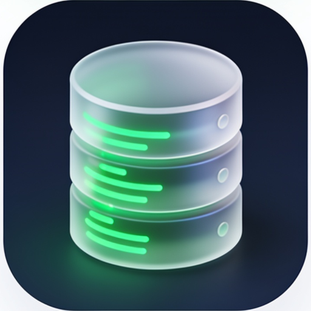

# 🤖 AI/ML & research

> Part of **[Awesome Bangladesh](../../README.md)** · All section guides: **[index](index.md)**

Models, benchmarks and research code from Bangladeshi labs and companies — from BUET's encoder models to Dhaka-built LLM families. Each entry notes its licence honestly: community-licence LLMs and non-commercial research checkpoints are labelled, so commercial users know what they can ship. Government AI assets are now here too, through the banglagov Hugging Face org.

**26 verified entries** · Last verified: 2026-10-25 · Rules: [curation policy](../curation-policy.md)

## The full table

| Project | What it does | Licence (as stated) | Bangladesh link |
|---|---|---|---|
| [banglagov (Hugging Face)](https://huggingface.co/banglagov) | Official Hugging Face org of the Bangla.gov.bd government initiative: banGPT2-Base, banBERT-Base, banELECTRA-Base and banT5-Base pretrained models plus the Ban-Sign-Sent-9K sign-language dataset | Licence terms per model card | 🔵 BD org / for-BD |
| [BanglaBERT](https://github.com/csebuetnlp/banglabert) | Pretrained Bangla language models from the BUET NLP group | ⚠️ CC BY-NC-SA 4.0 — non-commercial | 🔵 BD org / for-BD |
| [BanglaNLG](https://github.com/csebuetnlp/BanglaNLG) | BanglaT5 generation and summarisation models | ⚠️ No licence file | 🔵 BD org / for-BD |
| [mT5_multilingual_XLSum](https://huggingface.co/csebuetnlp/mT5_multilingual_XLSum) | Multilingual summarisation checkpoint covering Bangla | ⚠️ CC BY-NC-SA 4.0 — non-commercial | see list |
| [normalizer](https://github.com/csebuetnlp/normalizer) | Bangla text normalisation utilities used across the csebuetnlp stack | ⚠️ No licence file | 🔵 BD org / for-BD |
| [xl-sum](https://github.com/csebuetnlp/xl-sum) | Research code for the XL-Sum summarisation dataset | ⚠️ No licence file | 🔵 BD org / for-BD |
| [CrossSum](https://github.com/csebuetnlp/CrossSum) | Cross-lingual summarisation across 45 languages | ⚠️ No licence file | 🔵 BD org / for-BD |
| [IllusionVQA](https://github.com/csebuetnlp/IllusionVQA) | Optical-illusion visual question answering benchmark | ⚠️ No licence file | 🔵 BD org / for-BD |
| [bangla-bert-base](https://huggingface.co/sagorsarker/bangla-bert-base) | Community Bangla BERT, one of the most-used Bangla encoders on Hugging Face | MIT | see list |
| [bangla-bert](https://github.com/sagorbrur/bangla-bert) | Training and fine-tuning code for Bangla BERT models | MIT | see list |
| [bbocr](https://github.com/BengaliAI/bbocr) | Bangla handwriting OCR research | BSD-3-Clause | 🔵 BD org / for-BD |
| [graphemePrepare](https://github.com/BengaliAI/graphemePrepare) | Grapheme recognition data preparation | MIT | 🔵 BD org / for-BD |
| [BanglaConformer](https://huggingface.co/bengaliAI/BanglaConformer) | Conformer-based Bangla speech recognition model | MIT | see list |
| [BangalASR](https://github.com/menon92/BangalASR) | Automatic Bangla speech recognition experiments | MIT | 🟢 BD-based |
| [Bangla-Word2Vec](https://github.com/menon92/Bangla-Word2Vec) | Pretrained Bangla word embeddings | MIT | 🟢 BD-based |
| [banglanlptoolkit](https://pypi.org/project/banglanlptoolkit/) | All-in-one Bangla NLP toolkit from ACI MIS AI and Intelsense AI teams | ⚠️ Licence unspecified | 🟡 Diaspora |
| [BanglaBBQ](https://github.com/SummitAnthony/BanglaBBQ-benchmark) | Bias benchmark for question answering in the Bangladeshi context | MIT | see list |
| [bangla-speech-to-text-benchmark](https://github.com/riverbornai/bangla-speech-to-text-benchmark) | Open benchmark of eight Bengali speech-to-text APIs (Sarvam, Deepgram, Gemini, OpenAI, Groq Whisper and others) on 1,001 Bangla audio clips | MIT | 🟢 BD-based |
| [TituLM](https://huggingface.co/hishab/titulm-llama-3.2-3b-v2.0) | Open-weight Bangla LLM family from Hishab (Dhaka), trained on the titulm-bangla-corpus; paper arXiv 2502.11187 | Llama 3.2 community licence | 🟢 BD-based |
| [BanglaLLama](https://huggingface.co/BanglaLLM/bangla-llama-7b-instruct-v0.1) | Instruction-tuned Bangla LLM from the Bangladesh-led BanglaLLM org | Llama 2 community licence | 🟢 BD-based |
| [bangladeshi-bangla-tts-vits](https://huggingface.co/EMTIAZZ/bangladeshi-bangla-tts-vits) | Bangladeshi-dialect Bangla text-to-speech with running demo spaces, by a Dhaka-based ML engineer | Apache-2.0 | 🟢 BD-based |
| [BanglaTag](https://huggingface.co/arafatfahim/BanglaTag) | Bangla part-of-speech tagging model by a Dhaka developer | Apache-2.0 | 🟢 BD-based |
| [bengali-whisper-medium](https://huggingface.co/SayedShaun/bengali-whisper-medium) | Whisper fine-tune for Bangla speech recognition, Dhaka-based maintainer | Apache-2.0 | 🟢 BD-based |
| [BengaliRegionalASR (Barishal & Sylhet)](https://huggingface.co/sha1779/BengaliRegionalASR_barishal_sylhet) | Dialect-aware ASR trained on BengaliAI's regional-dialect data for two Bangladeshi divisions | Apache-2.0 | 🔵 BD org / for-BD |
| [@entrogic-net/mcp-server-bangladesh](https://www.npmjs.com/package/@entrogic-net/mcp-server-bangladesh) | MCP server exposing Bangladesh reference data to LLM clients, from the BanglaClaw team | Apache-2.0 | 🟢 BD-based |
| [bangla-news-mcp](https://pypi.org/project/bangla-news-mcp/) | MCP server that retrieves live Bangla news into LLM contexts, by Abid Mohammad Jawad (open source, GitHub hurutta/bangla-news-mcp). | — | 🟢 BD-based |

## Editor's picks

### [banglagov (Hugging Face)](https://huggingface.co/banglagov)

banGPT2, banBERT, banELECTRA and banT5 from the Bangla.gov.bd government initiative — the state publishing base models openly is new for Bangladesh and worth watching.

### **TituLM (Hishab)**

Open-weight Bangla LLM family from a Dhaka AI company with a public 24M-document corpus — the most complete local LLM stack currently published.

## How this section is verified

- Every link is fetched live at verification time — dead links are removed, not kept for history.
- Bangladesh connections are evidenced (profile location, org page, or the product's own docs) — see the [scope rules](../scope-and-eligibility.md).
- Dormant items (3+ years without activity) move to the [legacy file](../../legacy.md) with their last-activity date.
- Licence information is quoted as the publisher states it; gaps are flagged with ⚠️ rather than guessed.
