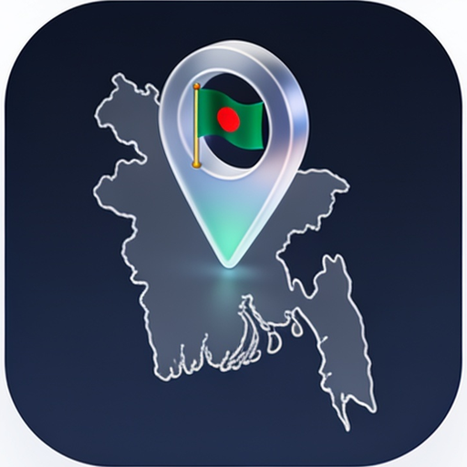

# 🔌 APIs & integrations

> Part of **[Awesome Bangladesh](../../README.md)** · All section guides: **[index](index.md)**

Public and free-tier APIs serving Bangladesh data — geography, prayer times, exchange rates, government services and more. Where an API needs a key we say so; keyless endpoints are marked as the easiest starting points. Live endpoints are checked during verification, not just their documentation pages. Official commercial APIs (payments, logistics) live in the Fintech and Services sections instead.

**15 verified entries** · Last verified: 2026-10-25 · Rules: [curation policy](../curation-policy.md)

## The full table

| Project | What it does | Licence (as stated) | Bangladesh link |
|---|---|---|---|
| [bdapis](https://github.com/AbmSourav/bdapis) | REST API for divisions, districts, upazilas, thanas, post offices and postcodes in Bangla and English; live at [bdapis.com](https://bdapis.com/) | MIT | 🟢 BD-based |
| [bdapi4all](https://github.com/fakhrul62/bdapi4all) | One keyless API for BD geography, prayer times, holidays, exchange rates and validators | ⚠️ Licence unspecified | see list |
| [bd-apis](https://github.com/SudipMHX/bd-apis) | Community collection of Bangladesh-focused APIs | ⚠️ No licence file | 🟢 BD-based |
| [bangla-apis](https://github.com/rdnasim/bangla-apis) | Curated directory of BD-context APIs (payments, couriers, SMS, government, banking, laws) with auth/pricing columns; reviewed October 2026 | Linked as a reference directory (no licence — data is not copied) | see list |
| [Bangladesh Bank daily rates](https://allratestoday.com/api/open/central-bank/bb) | Keyless JSON endpoint serving Bangladesh Bank's official published exchange rates (maintained by AllRatesToday with visible attribution). | — | 🔵 BD org / for-BD |
| [World Bank Bangladesh API](https://api.worldbank.org/v2/country/BGD/indicator/SP.POP.TOTAL?format=json) | Keyless REST API for every World Bank Bangladesh indicator, population to GDP (external service, CC-BY-4.0 terms). | Keyless REST API for every World Bank Bangladesh indicator, population to GDP (external service, CC-BY-4.0 terms) | 🔵 BD org / for-BD |
| [Bangladesh Railway e-ticketing API](https://railspaapi.shohoz.com/v1.0/web/all-trains/info) | Keyless JSON API behind the official Shohoz rail e-ticketing site — unofficial, no published terms; use respectfully. | — | 🔵 BD org / for-BD |
| [Open-Meteo (Bangladesh)](https://api.open-meteo.com/v1/forecast?latitude=23.8103&longitude=90.4125&hourly=temperature_2m) | Free keyless weather forecasts and history for any Bangladeshi coordinate (external service, non-commercial free tier, CC-BY-4.0). | Free keyless weather forecasts and history for any Bangladeshi coordinate (external service, non-commercial free tier, CC-BY-4.0) | see list |
| [bangladesh-bank-exchange-rate](https://www.npmjs.com/package/bangladesh-bank-exchange-rate) | npm client for Bangladesh Bank's daily published rates | MIT | 🔵 BD org / for-BD |
| [ExchangeRate-API open endpoint](https://open.er-api.com/v6/latest/BDT) | Free, keyless exchange rates for BDT, refreshed daily (community endpoint of ExchangeRate-API; external service, useful until Bangladesh Bank publishes an API). | — | see list |
| [Prothom Alo RSS](https://www.prothomalo.com/feed) | Verified RSS 2.0 feed of the leading Bangla daily. | — | see list |
| [The Daily Star RSS](https://www.thedailystar.net/frontpage/rss.xml) | Front-page feed of the leading English daily. | — | see list |
| [barta](https://github.com/iRaziul/barta) | Bangladeshi SMS gateways for Laravel | MIT | 🟢 BD-based |
| [laravelbdsms](https://github.com/arif98741/laravelbdsms) | Multi-gateway SMS package for Laravel covering Bangladeshi providers | MIT | 🟢 BD-based |
| [sms-service-with-bd-providers](https://github.com/sarahman/sms-service-with-bd-providers) | Laravel SMS service across BD providers | ⚠️ Licence unspecified | 🟢 BD-based |

## Editor's picks

### [bdapis](https://github.com/AbmSourav/bdapis)

Keyless REST API for divisions, districts, upazilas, post offices and postcodes in both Bangla and English — the fastest way to stand up anything geographic.

### **open.er-api.com BDT rates**

Free daily exchange rates for the taka without registration; replaced a popular API that never actually served BDT.

## How this section is verified

- Every link is fetched live at verification time — dead links are removed, not kept for history.
- Bangladesh connections are evidenced (profile location, org page, or the product's own docs) — see the [scope rules](../scope-and-eligibility.md).
- Dormant items (3+ years without activity) move to the [legacy file](../../legacy.md) with their last-activity date.
- Licence information is quoted as the publisher states it; gaps are flagged with ⚠️ rather than guessed.
