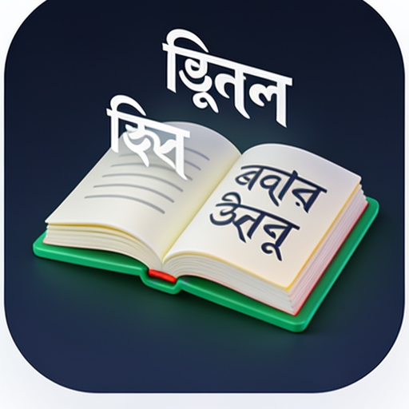

# 🏛️ Civic tech & public services

> Part of **[Awesome Bangladesh](../../README.md)** · All section guides: **[index](index.md)**

Technology aimed at public life: government portals, legal information, utility access and citizen services. The centrepiece is Bangla.gov.bd — the state's own Bangla-computing portal with AI assistants, OCR, corpus and fonts. Everything here is free to use; where a service is run by a government body we say so explicitly.

**6 verified entries** · Last verified: 2026-10-25 · Rules: [curation policy](../curation-policy.md)

## The full table

| Project | What it does | Licence (as stated) | Bangladesh link |
|---|---|---|---|
| [Bangla.gov.bd](https://bangla.gov.bd/bn) | The Bangladesh government's Bangla-language computing portal from the ICT Division (BCC): Kagaj AI writing assistant, Jijnsha AI government-service assistant, Borno OCR, the National Corpus, a Bangla spell checker, MS Word add-ins and free Bangla fonts, plus downloadable datasets and models on its [Hugging Face org](https://huggingface.co/banglagov) | Free to use; licence terms stated per tool | 🔵 BD org / for-BD |
| [protidhwani](https://github.com/ragib01-kuet/protidhwani) | Community safety intelligence platform | MIT | 🟢 BD-based |
| [nyayota](https://github.com/afnan0356/nyayota) | Bangladeshi legal information platform | MIT | see list |
| [desco-prepaid-api](https://github.com/KhBayazidAhmed/desco-prepaid-api) | DESCO prepaid electricity meter API documentation | ⚠️ No licence file | see list |
| [metrox-app](https://github.com/fahim2443/metrox-app) | Dhaka Metro Rail NFC card balance app | MIT | 🟡 Diaspora |
| [electric-bill-bd](https://www.npmjs.com/package/electric-bill-bd) | Electricity bill calculator for DESCO, DPDC, NESCO and other utilities | MIT | 🔵 BD org / for-BD |

## Editor's picks

### [Bangla.gov.bd](https://bangla.gov.bd/bn)

Kagaj AI writing assistant, Jijnsha AI government-service assistant, Borno OCR, the National Corpus and free fonts — the ICT Division's full-stack bet on Bangla computing.

### [protidhwani](https://github.com/ragib01-kuet/protidhwani)

Community safety intelligence platform showing how civic-tech thinking is evolving after the 2024 upheaval.

## How this section is verified

- Every link is fetched live at verification time — dead links are removed, not kept for history.
- Bangladesh connections are evidenced (profile location, org page, or the product's own docs) — see the [scope rules](../scope-and-eligibility.md).
- Dormant items (3+ years without activity) move to the [legacy file](../../legacy.md) with their last-activity date.
- Licence information is quoted as the publisher states it; gaps are flagged with ⚠️ rather than guessed.
