# 🚨 Crisis response

> Part of **[Awesome Bangladesh](../../README.md)** · All section guides: **[index](index.md)**

Flood, disaster and emergency-response tools for one of the most climate-exposed countries on earth. These projects matter most when they work offline-first, and that is exactly how the strongest ones are built — connectivity dies exactly when you need help most. Given the stakes, we track whether each project's data feeds and app-store listings are live: a crisis tool that 404s helps no one. Everything here is born from real Bangladeshi events, from annual haor flooding to the July 2024 internet shutdown.

**4 verified entries** · Last verified: 2026-10-25 · Rules: [curation policy](../curation-policy.md)

## The full table

| Project | What it does | Licence (as stated) | Bangladesh link |
|---|---|---|---|
| [Nongor](https://github.com/AuvroIslam/Nongor) | Offline-first flood SOS and crisis companion for Bangladesh: works when the network doesn't, which is the only moment it matters. Built for the annual flooding reality of the delta rather than adapted to it afterwards. | MIT | see list |
| [mukto-mesh](https://github.com/HyperZx2O/mukto-mesh) | Community mesh-network hub born from the July 2024 internet shutdown — when the national network goes dark, neighbourhoods can still talk to each other. A direct engineering response to a specific event in Bangladesh's history. | MIT | see list |
| [ResQ_Bangladesh](https://github.com/404Ah-Nafis/ResQ_Bangladesh) | Offline-first disaster response PWA — installable from the browser, no app store required, and functional without connectivity for reporting and coordinating during emergencies. | ⚠️ No licence file | see list |
| [HaorFloodAlert](https://github.com/shkoli/HaorFloodAlert) | Machine-learning flood prediction for the haor region — the low-lying Sylhet basin that floods first and hardest most years. Focused local forecasting instead of a generic global model. | MIT | 🟢 BD-based |

## Editor's picks

### [Nongor](https://github.com/AuvroIslam/Nongor)

The philosophy of this whole section in one project: assume the network is gone, then build the tool. An SOS companion that treats offline as the normal case is the only kind that actually works during a Bangladeshi flood, when towers are down and data networks collapse under load exactly when people need to signal for help.

### [mukto-mesh](https://github.com/HyperZx2O/mukto-mesh)

The July 2024 shutdown proved that connectivity itself can become a casualty. A community mesh hub lets a neighbourhood route around a national blackout — a resilience layer that had few open-source implementations tuned for Bangladesh before this.

## How this section is verified

- Every link is fetched live at verification time — dead links are removed, not kept for history.
- Bangladesh connections are evidenced (profile location, org page, or the product's own docs) — see the [scope rules](../scope-and-eligibility.md).
- Dormant items (3+ years without activity) move to the [legacy file](../../legacy.md) with their last-activity date.
- Licence information is quoted as the publisher states it; gaps are flagged with ⚠️ rather than guessed.
