# 🧰 Developer tools & libraries

> Part of **[Awesome Bangladesh](../../README.md)** · All section guides: **[index](index.md)**

The everyday toolbox: libraries, CLI utilities and frameworks that Bangladeshi developers build with and ship. Most are cross-platform and permissively licensed, so you can drop them straight into commercial work. Every entry has a maintainer we could verify as Bangladeshi (at home or diaspora) or a product explicitly built for Bangladesh. Registry-published packages here (npm, crates.io, PyPI, Packagist, RubyGems) are checked against the live registry, not just the repository.

**7 verified entries** · Last verified: 2026-10-25 · Rules: [curation policy](../curation-policy.md)

## The full table

| Project | What it does | Licence (as stated) | Bangladesh link |
|---|---|---|---|
| [DownGit](https://github.com/MinhasKamal/DownGit) | Downloads any GitHub directory or file as a zip archive straight from the browser — no clone, no sparse checkout. One of the most-forked Bangladeshi utilities on GitHub and a fixture in developer workflows worldwide. | MIT | 🟡 Diaspora |
| [@waveinno/ui](https://www.npmjs.com/package/@waveinno/ui) | "The React design system from Bangladesh" — a component library from the Dhaka product studio WaveInno, published on npm for production React apps. | MIT | 🔵 BD org / for-BD |
| [banglaclaw](https://www.npmjs.com/package/banglaclaw) | Web-scraping toolkit built for Bangladeshi use cases, published on npm (the original GitHub repo has since been deleted). Ships with helpers tuned to how local sites are actually built, which generic scrapers handle badly. | Apache-2.0 | 🟢 BD-based |
| [filex-editor](https://www.npmjs.com/package/filex-editor) | A Bangla-first terminal text editor, published on npm — typing, editing and saving Bangla text without leaving a terminal session or fighting font setup. | MIT | 🟢 BD-based |
| [Online-Compiler](https://github.com/shawon100/Online-Compiler) | Self-hosted online compiler platform — spin up a code-execution sandbox for a classroom or team on your own infrastructure instead of renting a judge0 bill. | ⚠️ No licence file | 🟡 Diaspora |
| [docker-beanstalkd](https://github.com/maateen/docker-beanstalkd) | Docker image for the Beanstalkd work queue, maintained by the Dhaka developer behind a string of developer-experience tooling. Pull-and-run instead of hand-configuring a queue server. | MIT | 🟡 Diaspora |
| [vim-for-devops](https://github.com/maateen/vim-for-devops) | DevOps-tuned Vim configuration: sensible defaults, plugin set and keybindings aimed at people living in SSH sessions and log files all day. | Custom licence | 🟡 Diaspora |

## Editor's picks

### [DownGit](https://github.com/MinhasKamal/DownGit)

A small tool that found a global audience: type a GitHub URL, get a zip of that directory. It solves the "I just want those three files, not the whole 400 MB repo" problem that every GitHub user hits eventually, and it has quietly become one of the most-forked Bangladeshi projects on the platform.

### [banglaclaw](https://www.npmjs.com/package/banglaclaw)

Scraping Bangladeshi websites is its own discipline — local encodings, local frameworks, local quirks — and this toolkit is built specifically for that reality instead of treating the Bangladeshi web as an afterthought. Published on npm with Apache-2.0, so commercial use is clean.

## How this section is verified

- Every link is fetched live at verification time — dead links are removed, not kept for history.
- Bangladesh connections are evidenced (profile location, org page, or the product's own docs) — see the [scope rules](../scope-and-eligibility.md).
- Dormant items (3+ years without activity) move to the [legacy file](../../legacy.md) with their last-activity date.
- Licence information is quoted as the publisher states it; gaps are flagged with ⚠️ rather than guessed.
