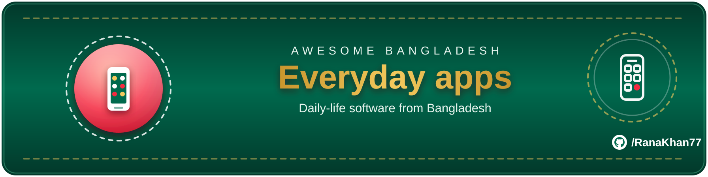

# 📱 Everyday apps

> Part of **[Awesome Bangladesh](../../README.md)** · All section guides: **[index](index.md)**

Open-source apps Bangladeshi people actually run: mess and household management, community platforms, publishing tools and the small utilities of daily life. Not developer libraries — these are finished products you install, self-host or open in a browser. Every entry ships working code and a Bangladesh connection we verified; the everyday-apps bar is deliberately high because this category attracts demo-ware.

**8 verified entries** · Last verified: 2026-11-06 · Rules: [curation policy](../curation-policy.md)

## The full table

| Project | What it does | Licence (as stated) | Bangladesh link |
|---|---|---|---|
| [Shelfie](https://github.com/Ifad7/shelfie) | Flask app that turns book photos into an organised library on Gemini's free tier; built-in EPUB/PDF reader — create shelves like 'বাংলা সাহিত্য' ... Book Feed: Western, Indian, Bangladeshi and Asian book news (incl. The Daily Star). | MIT | 🔵 BD org / for-BD |
| [Bookworm Buddies](https://github.com/mebmrauf/bookworm-buddies) | Plain-PHP community platform where readers in Bangladesh lend, swap and give away physical books; includes schema, seed data and PHP tests. | MIT | 🟢 BD-based |
| [BanglaChan (বাংলাচান)](https://github.com/tktajwar/bachan) | Self-hostable anonymous Bengali imageboard written in Rust: boards, threads and per-thread hashed user IDs, with no registration required. | AGPL-3.0 | 🟢 BD-based |
| [Recipe-Note (রাঁধুনি)](https://github.com/mahmud035/recipe-note) | Paste a Bengali YouTube cooking link, get an editable Bangla recipe and a print-ready PDF; runs end-to-end on a $0 hosting and API budget. | ⚠️ No licence file | 🟢 BD-based |
| [News Photocard Generator](https://github.com/mmrtonmoybd/news-photocard-generator) | Laravel 11 web app for creating branded, shareable Bangla news photocards with frames, Bangla-calendar dates and SSLCommerz payments — "It supports Bangla text and dates, and paid packages through SSLCommerz. Built with Laravel 11 and Filament 3" with admin panel and tests.. | ⚠️ No licence file | 🟢 BD-based |
| [Newspaper Office Management](https://github.com/mmrtonmoybd/newspaper-office-management) | Laravel back-office for newspaper offices: advertisement registers, Bangla cash books, press materials and circulation, with permissions — "Staff record advertisements, cash book income and expenses, press materials, and circulation in one place... The data entry screens are in Bangla" — আ/ন and আ/স registers.. | ⚠️ No licence file | 🟢 BD-based |
| [MessMate BD](https://github.com/Majortarif/messmate-bd) | All-in-one PWA for bachelors in Dhaka: mess (shared housing) management, money tracking and housing search, in Bangla and English — "The all-in-one life platform for bachelors in Dhaka... ঢাকার ব্যাচেলরদের মেস, টাকা, বাসা আর একা থাকার দিনগুলোর সঙ্গী" — Supabase RLS, CI, live app.. | ⚠️ No licence file | 🟢 BD-based |
| [90s Kid BD (নব্বইয়ের শিশু)](https://github.com/dhrupo/90skidbd) | Bangla nostalgia checklist of 1990s Bangladesh: tick 60 memories in 6 chapters, get a shareable SSC-style marksheet, challenge friends — "A Bangla nostalgia checklist for people who grew up in 1990s–early 2000s Bangladesh... a 1080×1350 মার্কশিট image shows your marks per subject" — Cloudflare Workers + Playwright tests.. | ⚠️ No licence file | 🟢 BD-based |

## Editor's picks

### [MessMate BD](https://github.com/Majortarif/messmate-bd)

Mess life — shared housing, meal costs, baki — is a universal Dhaka experience, and this PWA covers the whole of it: members, meals, monthly totals, in Bangla-first UI. It is exactly the kind of hyper-local software global products never bother to build.

### [BanglaChan](https://github.com/tktajwar/bachan)

A self-hostable anonymous Bengali imageboard written in Rust with 474 commits of care behind it. Community software in Bangla for Bangla communities, built to modern standards — the category is almost empty, which makes this stand out.

## How this section is verified

- Every link is fetched live at verification time — dead links are removed, not kept for history.
- Bangladesh connections are evidenced (profile location, org page, or the product's own docs) — see the [scope rules](../scope-and-eligibility.md).
- Dormant items (3+ years without activity) move to the [legacy file](../../legacy.md) with their last-activity date.
- Licence information is quoted as the publisher states it; gaps are flagged with ⚠️ rather than guessed.
