# Section guides

Deep-dive companions to the [main list](../../README.md) — one guide per section,
with full tables, editor's picks and verification notes.

- [🧰 Developer tools & libraries](developer-tools.md)
- [🗃️ Datasets & open data](datasets.md)
- [🔌 APIs & integrations](apis.md)
- [🇧🇩 Bangla language & NLP](bangla-nlp.md)
- [🤖 AI/ML & research](aiml.md)
- [💒 Fintech & e-commerce](fintech.md)
- [🛡️ Cybersecurity & privacy](security.md)
- [🏛️ Civic tech & public services](civic-tech.md)
- [🚨 Crisis response](crisis-response.md)
- [🗺️ Geography & open maps](geography.md)
- [🎓 Education & learning](education.md)
- [📚 Awesome lists & communities](awesome-lists.md)
- [🏪 Developer services (not open)](services.md)
