# 🔒 Cybersecurity & privacy

> Part of **[Awesome Bangladesh](../../README.md)** · All section guides: **[index](index.md)**

Security tooling by Bangladeshi researchers: web-application scanners, OSINT exposure checkers and BDIX network utilities. Scope is strict — reconnaissance and defensive tools yes, anything that exists to abuse real people (SMS bombers, phishing kits, piracy lists) is rejected at research time. Tools here are useful to security professionals everywhere, not only in Bangladesh, and each one is verified live before listing.

**5 verified entries** · Last verified: 2026-10-25 · Rules: [curation policy](../curation-policy.md)

## The full table

| Project | What it does | Licence (as stated) | Bangladesh link |
|---|---|---|---|
| [Website-Vulnerability-Scanner](https://github.com/RanaKhan77/Website-Vulnerability-Scanner) | Open-source web scanner with 202 deterministic modules: XSS, SQLi, SSRF, subdomain takeover, OWASP Top 10 checks, WordPress auditing and MCP/AI-LLM security tests. Runs as a self-hosted platform you point at your own sites before an outsider does. | MIT | 🟢 BD-based |
| [Exposure-Check-OSINT](https://github.com/RanaKhan77/Exposure-Check-OSINT) | Self-hosted OSINT exposure checker for email, username, phone and password leaks: 22 keyless sources, Have I Been Pwned k-anonymity lookups, and no API keys required — so you can audit your own footprint without handing credentials to a third party. | MIT | 🟢 BD-based |
| [2mny-security-scan](https://github.com/RanaKhan77/2mny-security-scan) | Continuous security-scan platform powering 2mny.com — scheduled scans, findings deduplication and per-site reporting, from the Dhaka security team behind much of this list's research tooling. | — | see list |
| [BDIX servers checker](https://github.com/0xAhmadYousuf/BDIX) | Checks and lists which servers are alive on BDIX, the national internet exchange — the starting point for anyone studying Bangladesh's domestic peering landscape. | MIT | 🟢 BD-based |
| [bdix-tester](https://gitlab.com/farhansadik/bdix-tester) | Tests which sites, FTP servers and download links are alive over BDIX connections. Hosted on GitLab, not GitHub — one of the few Bangladeshi tools that lives there. | Licenced (see repo) | 🟢 BD-based |

## Editor's picks

### [Website-Vulnerability-Scanner](https://github.com/RanaKhan77/Website-Vulnerability-Scanner)

The most complete open-source scanner built in Bangladesh: 202 deterministic modules across injection flaws, takeover risks and even MCP/AI-LLM security — a class of checks most commercial scanners added only recently. Deterministic means the same input produces the same findings, which makes it usable in CI without flaky false positives.

### [BDIX servers checker](https://github.com/0xAhmadYousuf/BDIX)

Small, sharp and uniquely Bangladeshi: a utility that only makes sense where a national internet exchange shapes how traffic flows. A good example of the local-knowledge tooling this list exists to surface.

## How this section is verified

- Every link is fetched live at verification time — dead links are removed, not kept for history.
- Bangladesh connections are evidenced (profile location, org page, or the product's own docs) — see the [scope rules](../scope-and-eligibility.md).
- Dormant items (3+ years without activity) move to the [legacy file](../../legacy.md) with their last-activity date.
- Licence information is quoted as the publisher states it; gaps are flagged with ⚠️ rather than guessed.
