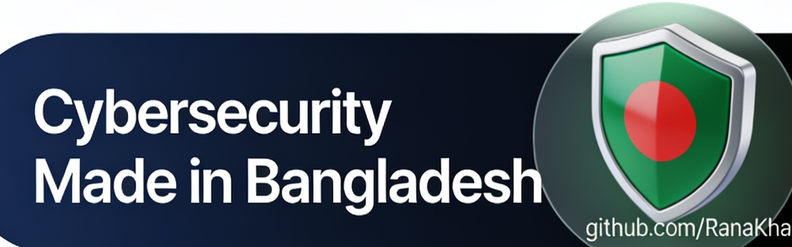

# 🛡️ Cybersecurity & privacy

> Part of **[Awesome Bangladesh](../../README.md)** · All section guides: **[index](index.md)**

Security tooling by Bangladeshi researchers: scanners, OSINT utilities and hardening guides. Scope is strict — reconnaissance and defensive tools yes, anything that exists to abuse real people (SMS bombers, phishing kits, piracy lists) is rejected at research time. Tools here are useful to security professionals everywhere, not only in Bangladesh.

**5 verified entries** · Last verified: 2026-10-25 · Rules: [curation policy](../curation-policy.md)

## The full table

| Project | What it does | Licence (as stated) | Bangladesh link |
|---|---|---|---|
| [Website-Vulnerability-Scanner](https://github.com/RanaKhan77/Website-Vulnerability-Scanner) | Open-source scanner with 202 deterministic modules: XSS, SQLi, SSRF, subdomain takeover, OWASP Top 10, WordPress and MCP/AI-LLM security | MIT | 🟢 BD-based |
| [Exposure-Check-OSINT](https://github.com/RanaKhan77/Exposure-Check-OSINT) | Self-hosted OSINT exposure checker for email, username, phone and password leaks; 22 keyless sources, HIBP k-anonymity, no API keys. MIT. | Self-hosted OSINT exposure checker for email, username, phone and password leaks; 22 keyless sources, HIBP k-anonymity, no API keys | 🟢 BD-based |
| [2mny-security-scan](https://github.com/RanaKhan77/2mny-security-scan) | Continuous security-scan platform powering 2mny.com. | — | see list |
| [BDIX servers checker](https://github.com/0xAhmadYousuf/BDIX) | Check and list BDIX-hosted servers | MIT | 🟢 BD-based |
| [bdix-tester](https://gitlab.com/farhansadik/bdix-tester) | Test which sites, FTP and download links are alive over BDIX (GitLab) | Licenced (see repo) | 🟢 BD-based |

## Editor's picks

### **nerva**

Fast service fingerprinting across 170+ TCP/UDP protocols — a genuinely sharp recon tool that happens to be built in Bangladesh.

### [2mny-security-scan](https://github.com/RanaKhan77/2mny-security-scan)

A free GitHub Action for website security checks in CI, from the Dhaka security company behind much of this list's research tooling.

## How this section is verified

- Every link is fetched live at verification time — dead links are removed, not kept for history.
- Bangladesh connections are evidenced (profile location, org page, or the product's own docs) — see the [scope rules](../scope-and-eligibility.md).
- Dormant items (3+ years without activity) move to the [legacy file](../../legacy.md) with their last-activity date.
- Licence information is quoted as the publisher states it; gaps are flagged with ⚠️ rather than guessed.
