# 🏪 Developer services (not open)

> Part of **[Awesome Bangladesh](../../README.md)** · All section guides: **[index](index.md)**

Commercial and free-tier services (not open source) that Bangladeshi developers integrate daily. These are listed separately so the open-source sections stay clean about what is actually open. Access models are stated honestly: sandbox-free, free-tier, or fully commercial. Nothing here is an advertisement — each service is one a verified BD developer actually builds against. Where an open-source SDK for the same service exists, it lives in [Fintech & e-commerce](fintech.md) or [APIs & integrations](apis.md) and is cross-linked from the table.

**14 verified entries** · Last verified: 2026-10-25 · Rules: [curation policy](../curation-policy.md)

## The full table

| Project | What it does | Licence (as stated) | Bangladesh link |
|---|---|---|---|
| [bKash Payment Gateway](https://developer.bka.sh/) | Bangladesh's dominant mobile financial service, exposed as a developer platform: Tokenized Checkout, refunds, payouts and webhooks. Access: sandbox free with registration. The community SDK ecosystem (Laravel, Flutter, Go, Rust) lives in the [fintech section](fintech.md). | — | 🔵 BD org / for-BD |
| [SSLCommerz](https://developer.sslcommerz.com/) | The country's most-used payment gateway aggregator: cards, net banking, MFS aggregation (bKash/Nagad/Rocket), hosted checkout and IPN. Access: sandbox free with registration. Official open-source integrations exist for Laravel, PHP, Flutter, WooCommerce and ASP.NET. | — | 🔵 BD org / for-BD |
| [aamarPay](https://developer.aamarpay.com/) | Hosted-checkout payment gateway with IPN support and ready-made plugins for popular Bangladeshi e-commerce stacks. Access: sandbox free with registration. | — | 🔵 BD org / for-BD |
| [Pathao Courier API](https://merchant.pathao.com/courier/developer-api) | Pathao's logistics API: order creation, pricing, zone lookup, tracking and OAuth2 auth. Access: sandbox via merchant account — register as a merchant to get credentials before coding. | — | 🔵 BD org / for-BD |
| [RedX Courier API](https://redx.com.bd/developer-api) | Courier operations with a published OpenAPI spec and sandbox — the cleanest API documentation among BD courier services, worth reading even if you ship with another provider. Access: sandbox via merchant account. | — | 🔵 BD org / for-BD |
| [Nagad](https://nagad.com.bd/) | The state-backed MFS with the second-largest user base. Access: merchant-only — there is no public developer portal; API documents are shared during merchant onboarding. Community SDKs exist (see the [fintech section](fintech.md)). | — | 🔵 BD org / for-BD |
| [upay](https://www.upaybd.com/) | MFS payments from United Commercial Bank. Access: merchant-only; the API PDF is shared with registered merchants. | — | 🔵 BD org / for-BD |
| [Barikoi](https://docs.barikoi.com/) | Bangladeshi geocoding, routing and place search, plus Rupantor for parsing Bangla-language addresses into structured data. Access: freemium — a free tier covers low volume, which is enough to prototype. | — | 🔵 BD org / for-BD |
| Porichoy | Government NID/KYC identity verification for regulated businesses (banks, telcos, fintechs). Access: paid merchant contract — budget for it only if you genuinely need real identity checks. The official portal domain (porichoy.gov.bd) was unresolvable at last verification, so it is not linked; see the [NID Wing services portal](https://services.nidw.gov.bd/) or check with [BNDA](https://bnda.gov.bd/) / your onboarding partner for current access. | — | 🔵 BD org / for-BD |
| BD SMS gateways ([BulkSMSBD](https://bulksmsbd.com/), [Alpha SMS](https://www.alpha.net.bd/sms/), [SSL Wireless](https://sslwireless.com/), [MiM SMS](https://www.mimsms.com/), [GreenWeb](https://greenweb.com.bd/)) | Bulk and masking SMS delivery — OTP flows, order notifications, marketing blasts. Access: paid, each with its own tariff. For code, abstract them behind the open-source [barta](https://github.com/iRaziul/barta) or [laravelbdsms](https://github.com/arif98741/laravelbdsms) packages instead of hand-rolling each provider's API. | — | 🔵 BD org / for-BD |
| [Bangladesh Bank exchange rates](https://www.bb.org.bd/en/index.php/econdata/econposition) | The official taka reference rates. Access: no API, and site terms apply. For programmatic use, the free keyless [open.er-api.com](https://open.er-api.com/) endpoint serves BDT rates cleanly. | — | 🔵 BD org / for-BD |
| [Survey of Bangladesh](https://www.sob.gov.bd/) | The national mapping authority's official base maps and geodata. Access: verbatim terms — no reproduction, no export, no resale. For open boundaries use [geoBoundaries](https://www.geoboundaries.org/) (CC-BY-4.0), HDX COD-AB (CC-BY-3.0 IGO) or OpenStreetMap (ODbL) instead — see the [geography section](geography.md). | — | 🔵 BD org / for-BD |
| [Bangladesh Meteorological Department](https://bmd.gov.bd/) | The national weather authority's observations and climate records. Access: purchase — there is no public developer API. For research and apps, use the open Kaggle weather datasets listed in the [datasets section](datasets.md) (including the 1901–2023 century series) or NOAA open data instead. | — | 🔵 BD org / for-BD |
| [Bangla AI Gateway](https://www.banglaai.org/) | Commercial Bangla LLM and OCR API. Access: commercial. The SDKs against it are free and open source: [bangla-ai on npm](https://www.npmjs.com/package/bangla-ai) and [bangla-ai-sdk on PyPI](https://pypi.org/project/bangla-ai-sdk/). | — | 🔵 BD org / for-BD |

## Editor's picks

### [bKash Payment Gateway](https://developer.bka.sh/)

The MFS that defines Bangladesh's digital payments. The Tokenized Checkout flow is well documented, sandbox access is free with registration, and the community SDK ecosystem around it — Laravel, Flutter, Go, Rust, Node — is the deepest of any Bangladeshi payment service. If you are building anything paid for the BD market, start here.

### **Open data instead of paid data**

Two rows in this table point you somewhere better: Survey of Bangladesh's restrictive licence is best replaced by the open boundary sources in the geography section, and the Meteorological Department's purchase-only climate data is best replaced by the century-long Kaggle weather series and NOAA open data in the datasets section. Knowing the open alternative is half the value of this table.

## How this section is verified

- Every link is fetched live at verification time — dead links are removed, not kept for history.
- Bangladesh connections are evidenced (profile location, org page, or the product's own docs) — see the [scope rules](../scope-and-eligibility.md).
- Dormant items (3+ years without activity) move to the [legacy file](../../legacy.md) with their last-activity date.
- Licence information is quoted as the publisher states it; gaps are flagged with ⚠️ rather than guessed.
